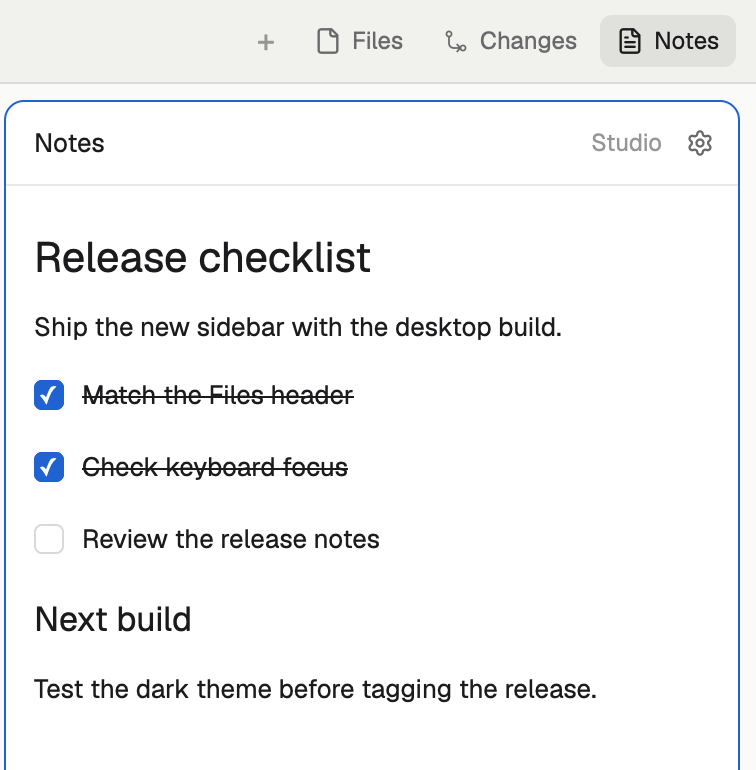

# Herdr Cockpit

Herdr Cockpit adds per-space Markdown notes, nested space groups, agent limits and host resource monitoring to Herdr desktop. Select **Notes** in Herdr’s layout picker to use it.



## Inside the layout

| Where | What you can do |
| --- | --- |
| **Notes** beside **Files** and **Changes** | Click the page to edit. Press **Escape** or click outside to return to the preview. Check off tasks directly in the preview. All tabs in a space share the same note. |
| **Spaces** sidebar | Right-click a space, choose **Move to group…**, then select a group or type a new name. Right-click a group and choose **Add Sub Group…** to nest it. Each machine has its own groups. |
| **Agents** sidebar and bottom status bar | See remaining context under Codex and Claude Code agents. Click the focused agent’s usage in the bottom bar for its five-hour and weekly limits, reported reset times and the past hour of usage. Remaining capacity turns amber at 20% and red at 10%. |
| **Host indicator** beside **Notes** | See CPU and RAM for local and connected hosts. Click the indicator to pick a host and inspect its five-minute CPU graph, memory, swap, free space on the home volume, network throughput, load and uptime. On narrow windows, use the host icon. |

## Install

Start Herdr desktop with its `herdr-app` CLI on `PATH`. Cockpit was tested with Herdr desktop 0.1.18 on macOS and a Linux host over SSH. Host monitoring supports macOS and Linux with Python 3.8 or later as `python3`. The Spaces sidebar uses Git on the machine that owns the checkout.

### From a Herdr chat

> Install the Notes layout from https://github.com/rafalwolak/herdr-cockpit. Follow the repository and installed Herdr AGENTS.md files. Keep my existing layout customizations.

### From a terminal on macOS or Linux

For a **first install**, clone the repository and run the commands below. They stop before copying if a destination already exists.

```sh
git clone https://github.com/rafalwolak/herdr-cockpit.git
cd herdr-cockpit
```

```sh
(
  set -eu
  app_dir="${HERDR_APP_HOME:-${XDG_CONFIG_HOME:-$HOME/.config}/herdr-app}"

  for entry in mods/* layouts/notes.json layouts/notes.png; do
    if [ -e "$app_dir/$entry" ] || [ -L "$app_dir/$entry" ]; then
      printf 'Destination already exists at %s\n' "$app_dir/$entry" >&2
      exit 1
    fi
  done

  mkdir -p "$app_dir/mods" "$app_dir/layouts"
  cp -R mods/* "$app_dir/mods/"
  cp layouts/notes.json layouts/notes.png "$app_dir/layouts/"
)
```

### Upgrade an existing Notes layout

Update your checkout with `git pull --ff-only`. Compare the five `mods/` directories with their installed copies and merge any local edits. In a customized `layouts/notes.json`, apply the five block bindings and keep your other panels, menus and sizes. The packaged layout and its preview can replace an unmodified copy. [Layout bindings](AGENTS.md#layout-bindings)

### Activate and verify

After installing or updating, run this from the checkout with Herdr open.

```sh
(
  set -eu
  app_dir="${HERDR_APP_HOME:-${XDG_CONFIG_HOME:-$HOME/.config}/herdr-app}"
  for mod in mods/*; do
    herdr-app check "$app_dir/$mod"
  done
  herdr-app do layout.switch '{"name":"notes"}'
  herdr-app status
)
```

The status output should show `"layout": "notes"` and `"errors": []`. To return to Herdr’s default layout, run `herdr-app do layout.switch '{"name":"main"}'`. Open terminals keep running.

## Agent usage and reset times

Cockpit reads agent status from Herdr terminal labels and footers through `hc`. It can also query `codex app-server` for account limits. For Codex sessions opened through Herdr Chat, it reads usage from the matching session log. **Usage pending** means the focused session has yet to report a recognized reading. The status bar shows capacity remaining. The history chart plots capacity used.

Claude Code can report usage through a recognized terminal footer. For exact reset times on macOS or Linux, merge this optional field into Claude Code’s user settings (normally `~/.claude/settings.json`) on each machine where Claude runs. On an SSH host, first copy `mods/notes-usage-status/claude_status.py` to the same mod path under that host’s Herdr app home. Reset timestamps appear when Claude supplies them. [Claude Code status-line settings](https://code.claude.com/docs/en/statusline)

```json
{
  "statusLine": {
    "type": "command",
    "command": "python3 \"${HERDR_APP_HOME:-${XDG_CONFIG_HOME:-$HOME/.config}/herdr-app}/mods/notes-usage-status/claude_status.py\""
  }
}
```

If you have a status-line renderer, append its existing command as one shell-quoted argument to `claude_status.py`. The bridge passes through its input, output and exit code. With the example above, usage appears in Herdr and the Claude terminal status line is blank.

## Notes and storage

Notes autosaves Markdown on the computer running Herdr, including notes for SSH spaces. Each filename uses the space ID, so renaming a space keeps its note. Use the gear menu to **Reveal file**, **Copy path**, change appearance or undo a cleared note. External edits refresh the preview. If a file changes while you have unsaved edits, Notes keeps your draft for a manual merge.

| Desktop platform | Notes directory |
| --- | --- |
| macOS | `~/Library/Application Support/Herdr/notes/` |
| Linux | `~/.local/share/herdr/notes/` |
| Windows | `~/AppData/Local/Herdr/notes/` |

Herdr saves group membership and collapse state in shared `space-groups` data and keeps up to an hour of usage readings per agent session in mod storage. The five-minute host graph lives in memory.

To toggle Notes with **Option+Shift+N** on macOS, merge this binding into your Herdr app’s `keys.json`.

```json
{
  "layout:notes": {
    "alt-shift-n": "notes-tabs.toggle-notes"
  }
}
```

## Development

Herdr loads the JavaScript mods directly. Run the tests from the repository root with Node.js and Python 3. Node.js 22.22 and Python 3.13 are a tested combination.

```sh
node --test tests/*.test.mjs
```

The layout recipe describes native interactions and visual details. The contributor guide covers mod boundaries and how to verify changes in Herdr. [Layout recipe](RECIPE.md) · [Agent instructions](AGENTS.md)

## Credits

Cockpit is a fork of itspanicky’s Notes layout and adapts native Herdr tabs, sidebars and status controls. [Original Notes](https://github.com/itspanicky/herdr-notes) · [Herdr desktop](https://github.com/herdrdev/herdr-app/tree/v0.1.18) · [Apache 2.0](mods/notes-space-groups/LICENSE-APACHE)

Nested groups build on Space Groups. The optional chat peek integration comes from Herdr Chat. [Space Groups](https://github.com/suppa-duppa-labs/herdr-space-groups) · [Group notices](mods/notes-space-groups/NOTICE) · [Icon licenses](mods/notes-space-groups/LICENSE-ICONS) · [Herdr Chat](https://github.com/ChmaraX/herdr-chat) · [Chat adapter license](mods/notes-usage-agents/LICENSE-CHAT)
